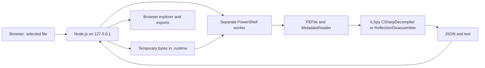

# Lupa.NET

**A local .NET assembly explorer with C# decompilation and IL inspection, powered by ILSpy.**

Lupa.NET turns managed PE files into a searchable view of types, methods, signatures, references, metadata, and string literals. A browser interface talks to a loopback-only Node.js server, which delegates static analysis to a separate PowerShell-hosted C# worker.

## Why I built it

I built Lupa.NET during a defensive investigation into malware received by the company I work for. It was used to inspect a recovered .NET payload, decompile its managed code, and compare reconstructed C# with IL to understand the capabilities present in the sample.

That experience motivated a tool that makes binary structure easier to navigate and findings easier to record. The investigation used static inspection; the malware was not executed on the analysis workstation. Finding code in a payload does not prove that it ran on an affected computer or that data was stolen.

This public repository shares the analysis tool and a harmless demonstration assembly. Malware samples, recovered malware source, company information, employee data, incident logs, and command-and-control details are excluded. This is a personal project, with no claim of employer or ILSpy endorsement.

## Features

- Open managed `.dll`, `.exe`, and `.bin` PE/CLI assemblies up to 32 MiB.
- Browse and search namespaces, types, methods, and signatures.
- Read reconstructed C# and disassembled IL by method; the API also supports type tokens.
- Inspect SHA-256, MVID, assembly version, architecture, declared references, and `#US` strings.
- Filter string literals, export the current view as text, and download a JSON report.
- Keep browser-local notes keyed by the assembly's SHA-256.
- Work offline after obtaining the repository and prerequisites: no CDN, npm dependencies, telemetry, or automatic dependency downloads.

This version focuses on managed .NET code. It does not decompile arbitrary native machine code, automatically decrypt every string, recover missing plugins, or restore the original source project.

## Quick start

**Tested platform:** Windows, Node.js 24, PowerShell 7.6.5 with .NET 10 runtime libraries. Node.js 22+ is required. PowerShell 7.5+ is the intended minimum, but versions other than the tested runtime still need validation. Windows PowerShell 5.1 is not supported. Linux and macOS have not been validated.

No .NET SDK or npm package installation is required for normal use. The pinned ILSpy engine and the harmless demo are included.

```powershell
git clone https://github.com/Inwtn/lupa-net.git
cd lupa-net
npm run verify
pwsh -NoProfile -File ./Start.ps1
```

Alternatively, with `node` and `pwsh` on `PATH`:

```text
npm start
```

Open **http://127.0.0.1:4318**, then select **Open demo**. The demo contains a calculator and simple messages. Its methods are decompiled, not called. Stop the server with `Ctrl+C`.

To select a different port or PowerShell installation before `npm start`:

```powershell
$env:LUPA_PORT = '4320'
$env:LUPA_PWSH = 'C:\Program Files\PowerShell\7\pwsh.exe'
npm start
```

## Using the explorer

1. Open a managed assembly or drop one file into the window.
2. Search the tree and select a method. The first request starts an analysis worker; subsequent requests can use the session cache.
3. Switch between **C#**, **IL**, **Metadata**, and **Strings**. Press `/` to focus the tree search.
4. Review the file identity, declared references, and warnings in the details panel.
5. Add notes and export the current text or JSON report. Notes remain in this browser unless you export them.

## How it works



The worker loads the trusted ILSpy library and this project's analyzer. It reads the target with PE/metadata APIs rather than loading it as executable code into the CLR. Dependencies are resolved only from the trusted PowerShell runtime directory. Target neighbors, embedded search paths, NuGet packages, and debug symbols are not fetched.

See [architecture](docs/ARCHITECTURE.md) for the request flow, API, and limits, and [engine provenance](docs/ENGINE.md) for the pinned dependency and the role of REA.

## Security and limitations

**Static analysis is not an operating-system sandbox.** Workers run with your user account's permissions, and malformed files remain input to complex parsers. For suspicious files, use a dedicated isolated analysis environment with no company credentials or host shares. The application does not enforce network isolation for the worker.

The server binds to `127.0.0.1`, checks hosts and origins, serves only an explicit file allowlist, and checks the ILSpy DLL hash before analysis. It is designed for a single local user; do not expose it through a public reverse proxy or treat these checks as authentication.

Imported bytes are copied into `.runtime/`. Up to eight assemblies are retained per server session. Replacement and normal shutdown attempt to delete those copies; crashes or forced termination may leave files behind. Browser notes and exported reports can also contain sensitive data. Review them before sharing.

C# is reconstructed output. Obfuscation, missing dependencies, unusual IL, mixed-mode code, and malformed metadata can make it incomplete or misleading. Display limits and worker timeouts are safeguards, not absolute memory limits. The application does not patch binaries, compile recovered code, debug targets, or execute their entry points.

See [SECURITY.md](SECURITY.md) for the trust boundary and reporting guidance.

## Repository layout

| Path | Purpose |
| --- | --- |
| `public/` | English HTML, CSS, and JavaScript interface |
| `server.cjs` | Loopback HTTP API, uploads, sessions, cache, and worker lifecycle |
| `backend/Analyzer.cs` | Static metadata inspection and C#/IL output |
| `backend/analyze.ps1` | Engine integrity check and trusted worker compilation |
| `demo/` | Harmless fixture source, compiled assembly, and rebuild script |
| `vendor/` | Pinned official ILSpy NuGet package and extracted files |
| `docs/` | Architecture, provenance, validation, and third-party license notices |
| `scripts/` | Distribution manifest generation and verification |
| `tests/` | Integration and HTTP boundary tests using the harmless fixture |

## Development and validation

```text
npm test
npm run verify
```

The integration suite inspects only the harmless demo and deliberately malformed test bytes. It checks metadata, C#/IL output, import identity, invalid PE handling, upload limits, origin/host restrictions, token validation, and private-file access. It never executes an analyzed assembly. See [validation](docs/VALIDATION.md).

After intentionally changing distributed files, review your diff and regenerate the integrity manifest with `npm run manifest`. Hash verification detects changes relative to that manifest; it is not a publisher signature or a malware verdict.

Contributions should include English documentation and benign test inputs. Read [CONTRIBUTING.md](CONTRIBUTING.md) before submitting a change.

## Credits and license

Lupa.NET's own code is licensed under the [MIT License](LICENSE). Its decompilation engine is [ICSharpCode.Decompiler from ILSpy](https://github.com/icsharpcode/ILSpy), version **11.1.0.9782**. Lupa.NET is an independent interface built around that engine, not a replacement implementation of ILSpy's decompiler. Third-party code retains its own copyright and notices; see [THIRD_PARTY_NOTICES.md](THIRD_PARTY_NOTICES.md).
